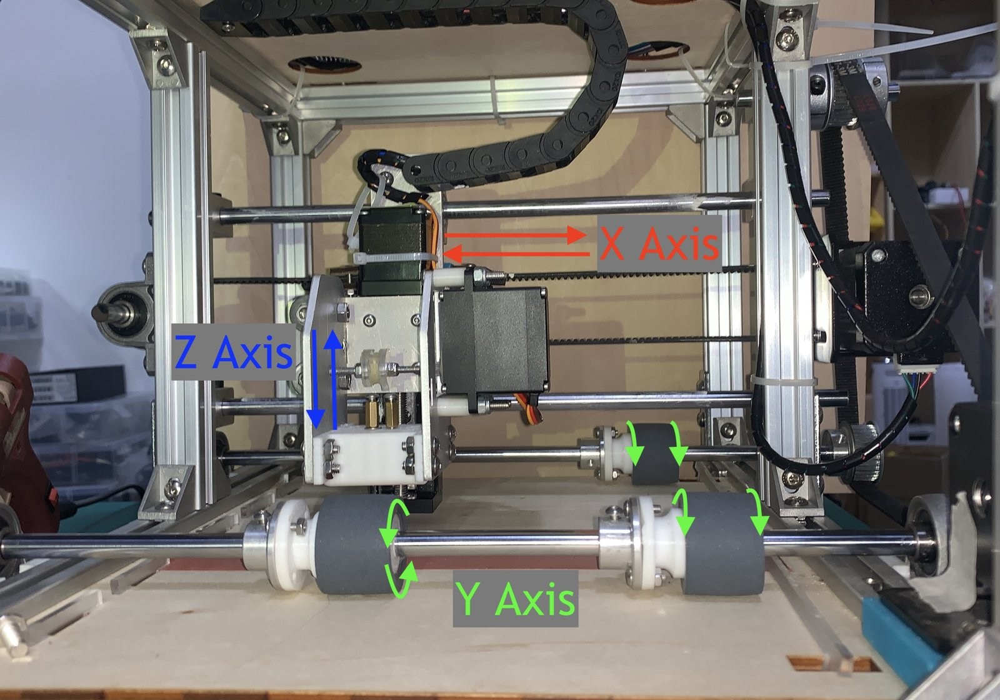
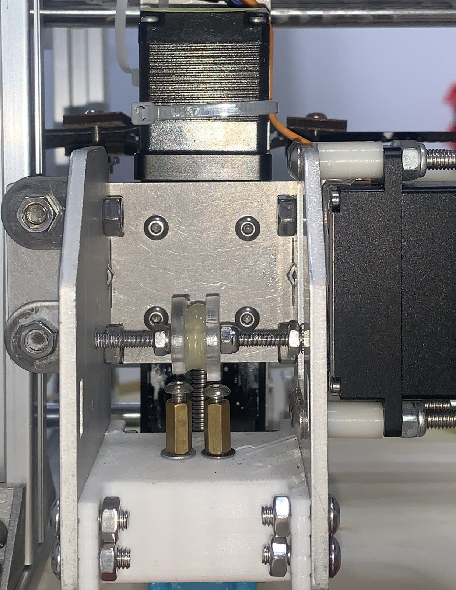
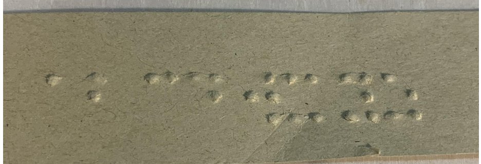

Commercial braille embossers cost $2,000 to $5,000 and rely on loud linear solenoids. This design uses a camshaft instead.

## How it works

A 360° servo turns a camshaft with two cams. Two print pins sit directly under the cams, and the cams are shaped so that every combination of the two pins, dot or no dot, comes up at some angle. To print a column of a braille cell, the servo turns to that angle and the head presses down.

The rest of the machine is three axes:

- **X.** A belt drive moves the printhead left and right along a line.
- **Y.** Rollers feed the paper in, advance it one line at a time, and push it out.
- **Z.** A lead screw lowers the printhead so the pins press dots into the paper.

*Left: the three axes. Right: the printhead, with the camshaft above the two pins.*

## Testing

I printed "abcdwxyz" five times and measured the dots. They averaged 0.32 mm tall, within ±0.12 mm. After four rounds of durability testing, each dot lost about 0.028 mm of height on average. I also built a four-pin printhead to find the most pins the cams could drive while keeping that accuracy.

*"abcdwxyz", embossed by the machine.*
