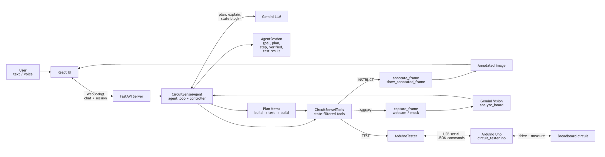

Describe a circuit in plain language, and Circuit Sensei walks you to a working Arduino build.

- **Plan and guide.** Generates a build plan and draws step-by-step breadboard diagrams.
- **Verify.** Checks each part through a webcam with Gemini Vision, and won't continue until the step is right.
- **Test.** Generates Arduino code, uploads it over serial, and runs electrical tests on the finished circuit. Build and test steps alternate, so mistakes show up where they happen.

The Arduino runs a small JSON command interpreter over USB serial, which is how the agent drives the tests.

*How the agent moves from a request to a tested circuit.*
