Cove was built to grab a wine bottle and pour it. The end effector cradles the bottle, and the rest of the arm is seven BLDC actuators joined by milled aluminum brackets.

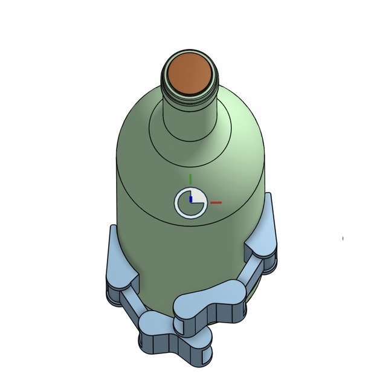
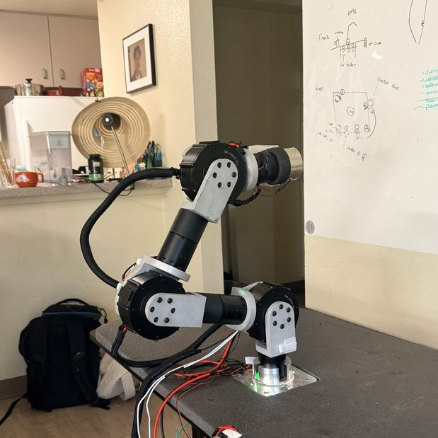
*Left: the gripper in CAD. Right: the arm extended during testing.*

## What I owned

- **Control architecture.** ROS 2 on a Raspberry Pi 5, commanding CAN-based BLDC actuators through a Waveshare CAN HAT.
- **Actuator bring-up.** CAN communication with seven Damiao actuators in position-velocity mode.
- **Safety.** A hardware and software e-stop with a heartbeat timeout, torque cutoff, and ROS 2 fault monitoring.
- **Robot model.** A URDF with joint dynamics, transmission tags, and collision geometry that matches the real arm, for MoveIt 2.

## How it fits together

MoveIt 2 plans a motion, using AprilTags to find its target, and publishes joint targets on `/target_joints`. The control node on the Pi talks to the seven actuators over CAN through a Waveshare CAN HAT. The actuators report back, and the Pi publishes `/joint_states`. If the heartbeat stops, torque is cut and `/estop_event` tells every other node.

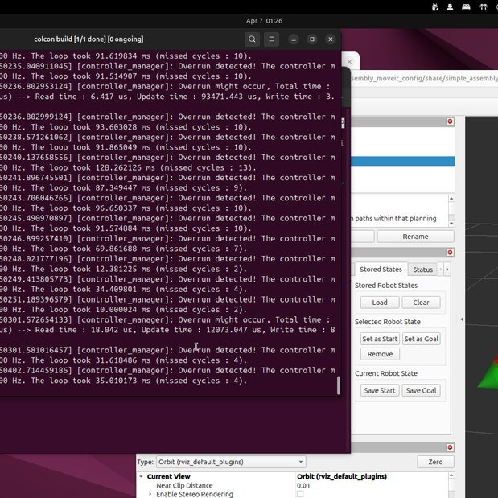
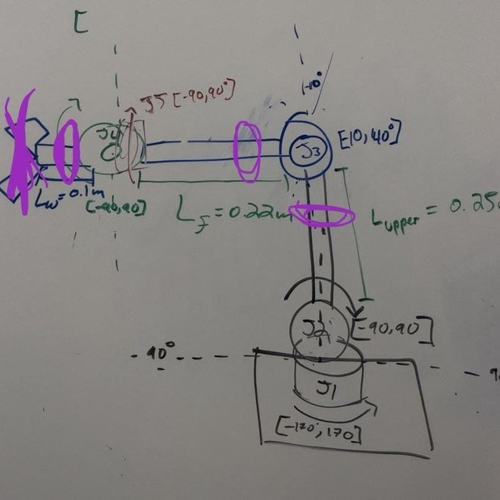
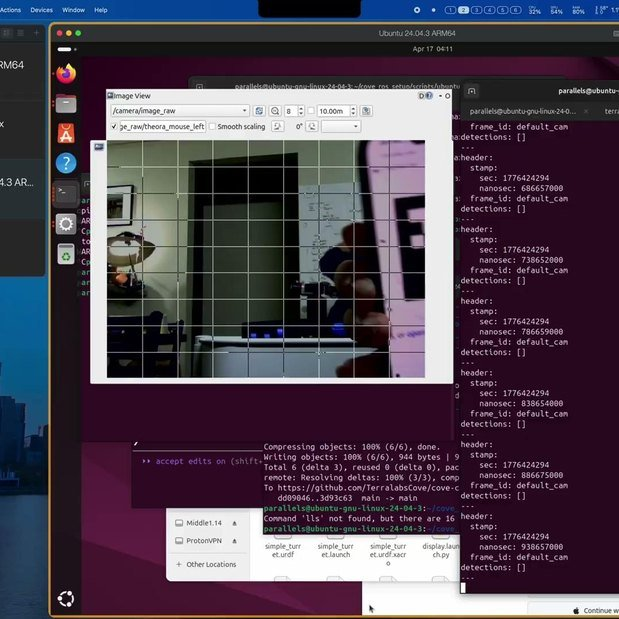
*The ROS 2 controller running alongside RViz, working out link lengths and joint limits on the whiteboard, and calibrating the camera.*

## Building it

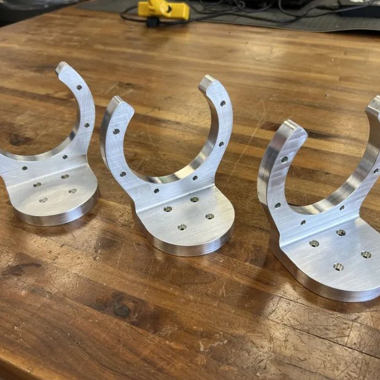
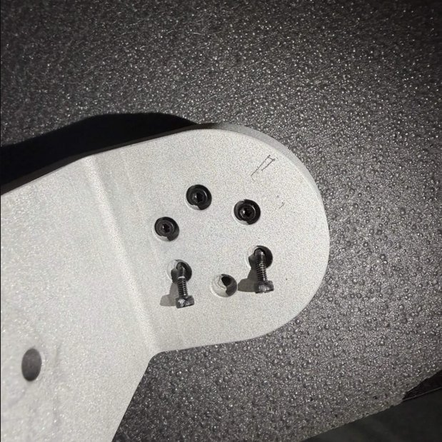
*Machined aluminum brackets, and a bracket plate up close.*

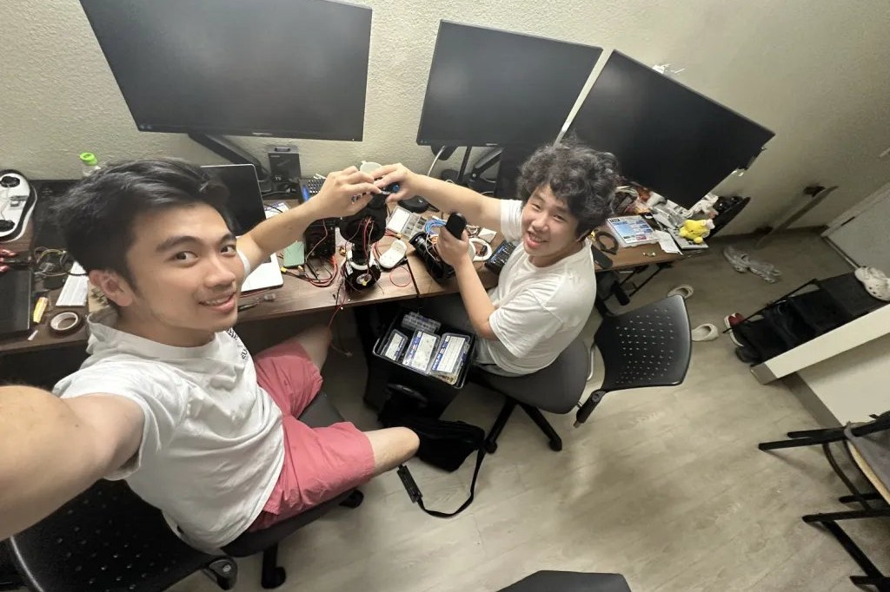
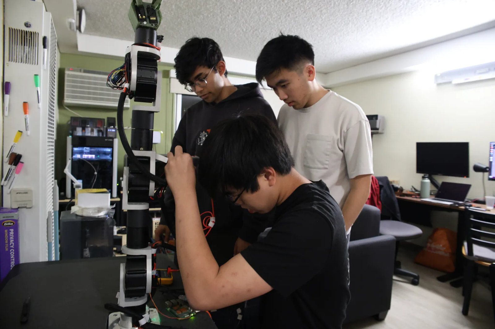
*Working on the arm with the team.*

## Decisions

**Position-velocity control.** Each actuator gets a target position and the speed to move there at, so MoveIt 2's joint targets go straight to the motors.

**E-stop in hardware and software.** A heartbeat timeout cuts torque when the control link goes quiet, and ROS 2 fault monitoring publishes the event so every node knows.

**Get the URDF right.** We didn't lean on simulation, so the model had to match the real arm. I put a lot of work into getting the link lengths, joint limits, dynamics and collision geometry accurate, because MoveIt 2 plans from that model and any error shows up as a bad motion on the real arm.

## What broke

The base threads stripped under load. The failure broke four actuators and damaged fuses and CAN ports. I helped bring the arm back: rewired it, rebuilt it, and redid the wireless system. We replaced the hardware with rated stainless fasteners and torqued every one to spec.

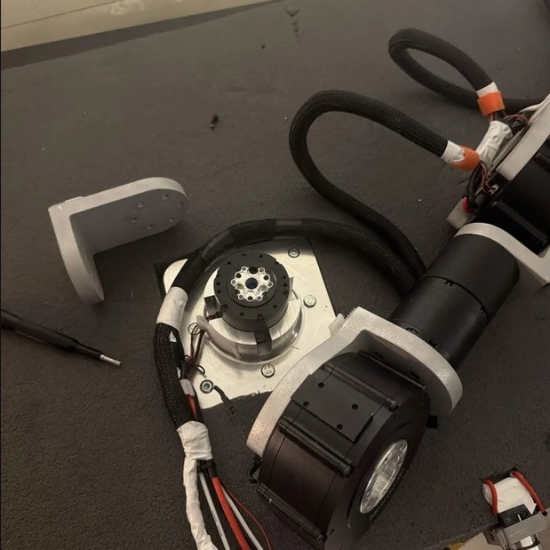
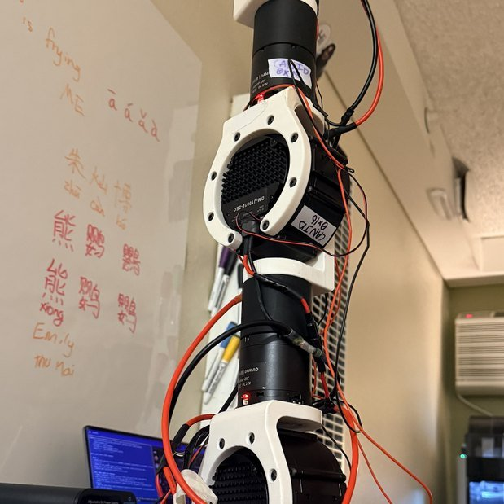
*Inside an actuator, and the arm with its wiring exposed.*

## What came next

Cove became the starting point for [Tether](../tether/), a 7-DOF inchworm robot made of three wireless modules.
