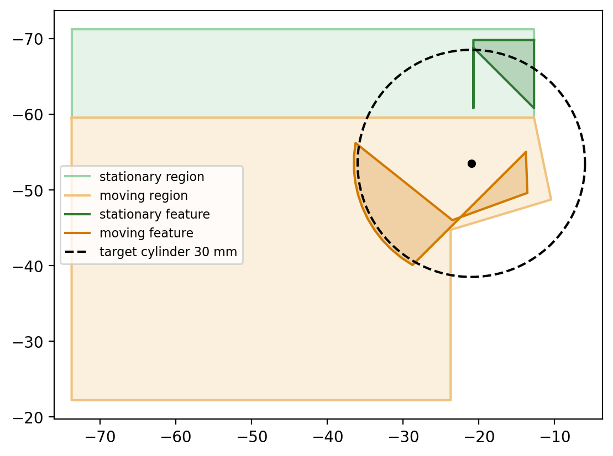

A software agent can call tools. A hardware agent should be able to make them. That was the idea behind ID0, which we built at Y Combinator's RoboHacks.

## How it works

1. **Look at the task.** The robot scans the scene and works out what it needs to manipulate, what kind of end effector that takes, and whether the one it has is good enough.
2. **Design a tool.** If it isn't, the robot designs a new end effector with programmatic CAD, built on top of a universal tool-changer interface.
3. **Print it.** The tool prints as a single piece. Multicolor printing adds AprilTags, so the robot can find the tool at the printer.
4. **Use it.** The robot picks up the new tool, mounts it, and finishes the task.
5. **Put it away.** Afterward the tool goes back to a garage, so the robot builds up a library of tools it can reuse and decides when each one fits.

## My part

I built the two steps between seeing the task and having a printable tool.

- **Scene understanding.** Gemini looks at the camera image and returns a structured description of the object: what it is, and the grasp constraints a tool would need to meet.
- **Generating the end effector.** Those constraints become the prompt for a model that writes CadQuery code. The mounting interface stays human-designed and trusted. The generated geometry is built on its mating face, inside size limits and keep-out zones, so a bad generation can't break the part that attaches to the robot.

*Working out where a claw's stationary and moving fingers can go to grip a 30 mm cylinder.*

## A fun fact

We built ID0 about two weeks before an Onshape MCP came out that lets Claude work directly inside Onshape. We were a little ahead of the game.

## What's next

Hardware doesn't have to stay fixed. If a robot can make the physical capability a task needs instead of being stuck with the hardware it started with, it can take on far more work on its own. We plan to keep pushing the idea forward.
