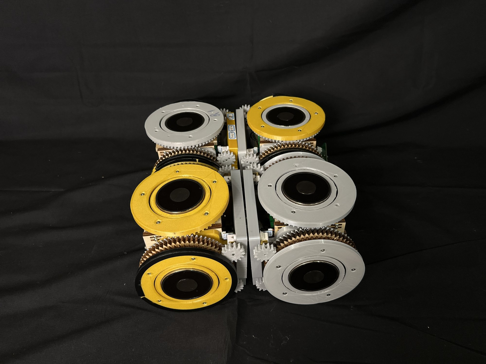
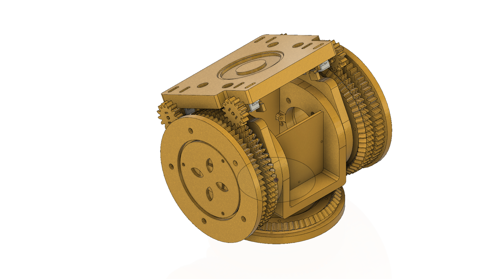
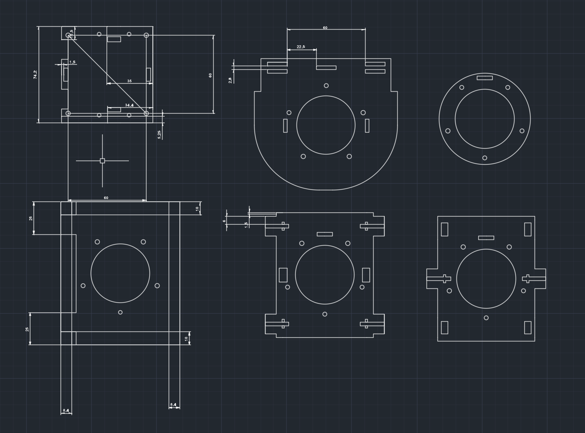
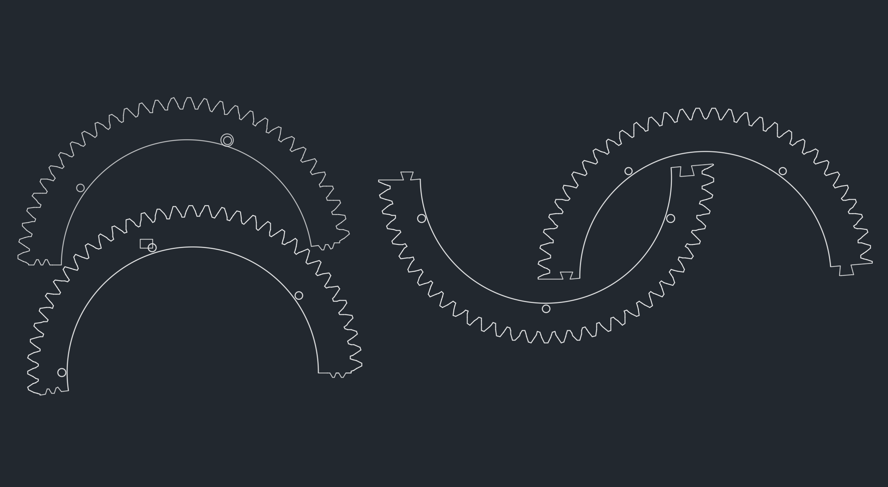
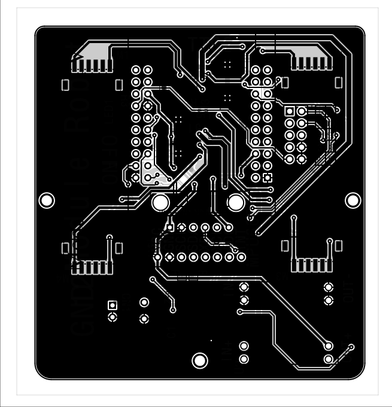

## Why I built it

In spring 2022, Shanghai went into a three-month lockdown. For weeks it was hard to get food or supplies delivered, because the people who run logistics couldn't go to work. I started asking how delivery networks could keep working when that happens.

A lot of what I read pointed to flexibility and adaptability, and modular robots have both. Most modular robotics research was aimed at search and rescue or static structures, so I wanted to see whether robots that solve problems together could make logistics more reliable and less dependent on people.

## How it works

Each module has four degrees of freedom, drives on wheels, and connects to its neighbors with electromagnets. A computer tracks every module with AprilTags and OpenCV and sends commands over ESP-NOW. On each module an ESP32 runs PID control to position it precisely.

*Left: four modules assembled into one robot. Right: the module in CAD.*

## Drawings and electronics

The frame and gears have full 2D drawings, and a custom extension board carries the module's electronics.

*The center frame, the bevel gear halves, and the extension board's front copper.*

## Testing

I tested how fast the robots move in different assembled configurations, how fast they move carrying cargo, and how strong the connections between modules are. I also built obstacle setups to test whether the system could assemble itself to get through them.

The modules move at 0.2 m/s, and the electromagnetic connections between them hold up to 339 N.

## Awards

The project won First Award in Embedded Systems at Regeneron ISEF in 2023. ISEF then sent me to represent it at the EU Contest for Young Scientists, where the project won a top award.
