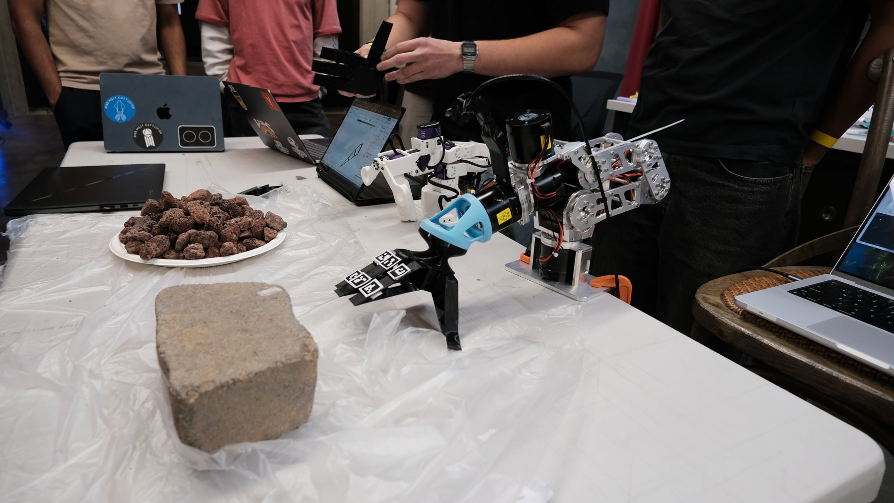
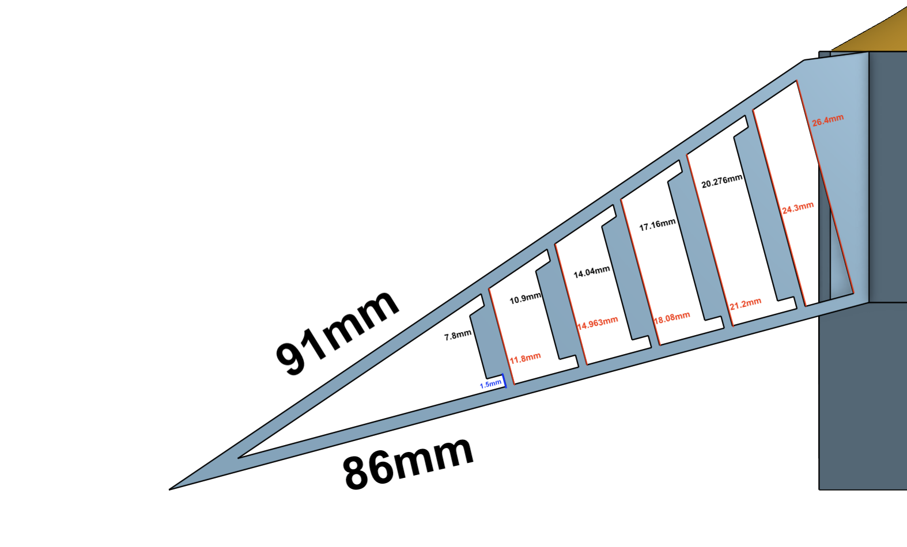
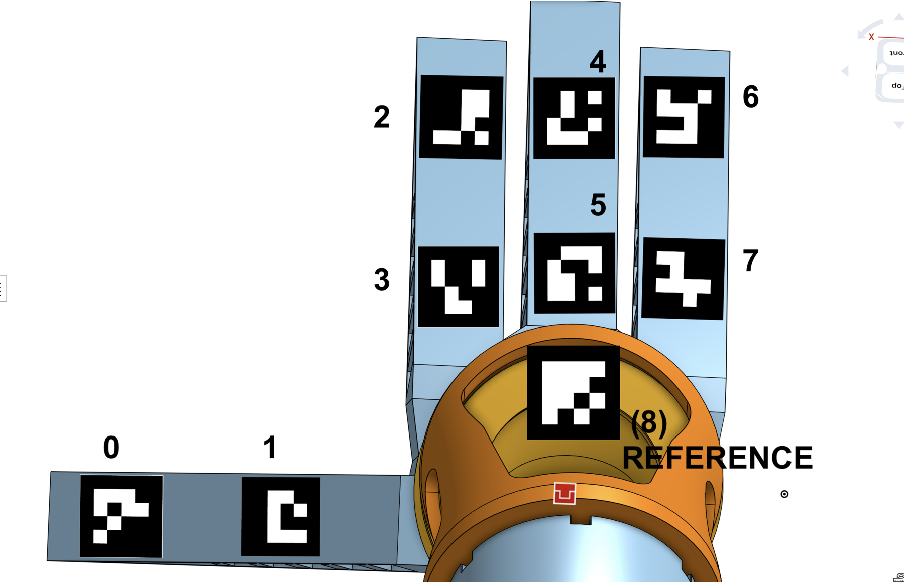
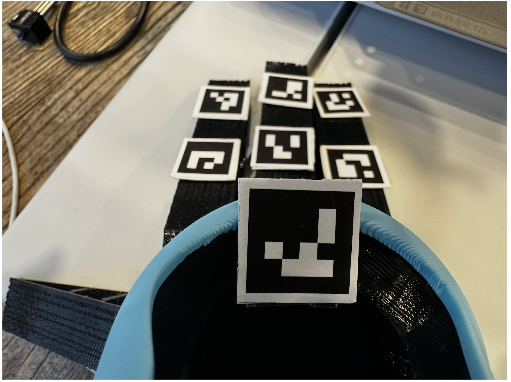
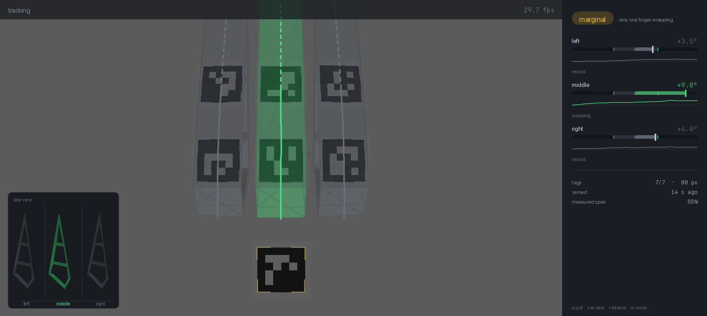
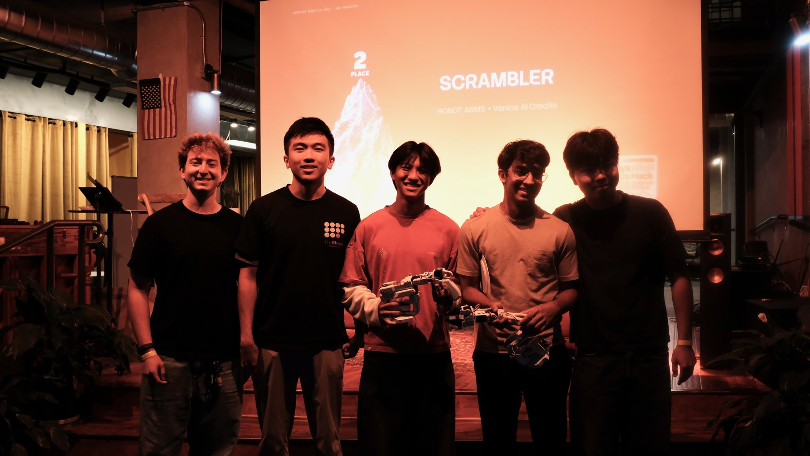

Scrambler is a fully passive climbing hand for the Unitree G1. It lets the humanoid drop to all fours and scramble up terrain steeper than it can walk, with no added motors, wiring or firmware. TPU Fin Ray fingers turn the robot's weight into grip.

*Left: the test setup at the hackathon. Right: one compliant finger from the side.*

## FlexSense: my part

A passive hand has no sensors, so the robot can't tell whether it's actually gripping. FlexSense fixes that with no electronics in the hand at all: ArUco markers on each finger, tracked by a wrist camera, measured against a reference marker on the cuff.

*Left: the marker layout, designed from the camera's point of view. Right: what the camera actually sees.*

- **Pose estimation.** Full 6-DoF marker tracking, with the IPPE pose ambiguity resolved from frame to frame.
- **Calibration.** Calibrating against an animated target on a screen worked better than a printed ChArUco board.
- **Simulation.** A co-rotational Euler-Bernoulli FEM solver with a Yeoh hyperelastic TPU model predicts how a finger bends under load.
- **Live tool.** Classifies each finger as wrapping, neutral, or bending back, and draws the bent CAD over the camera view. 123 unit tests.

*The live tool: each finger's bend angle, with a side-view sketch in the corner.*

*The Scrambler team after presenting.*
