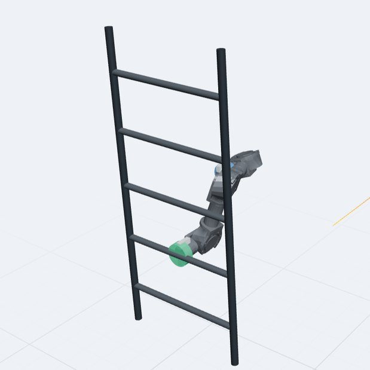
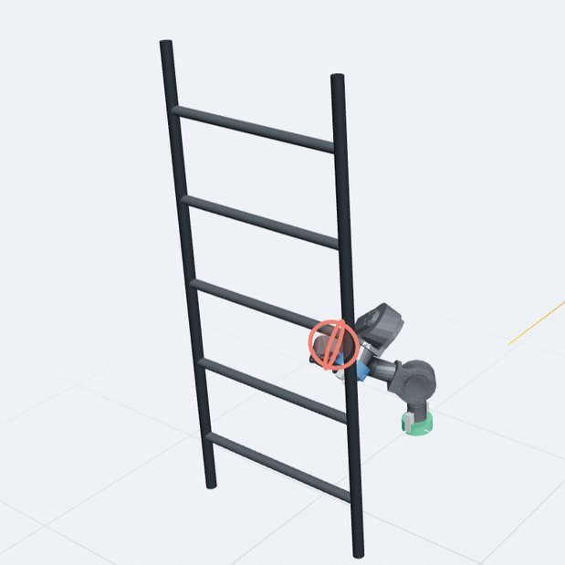
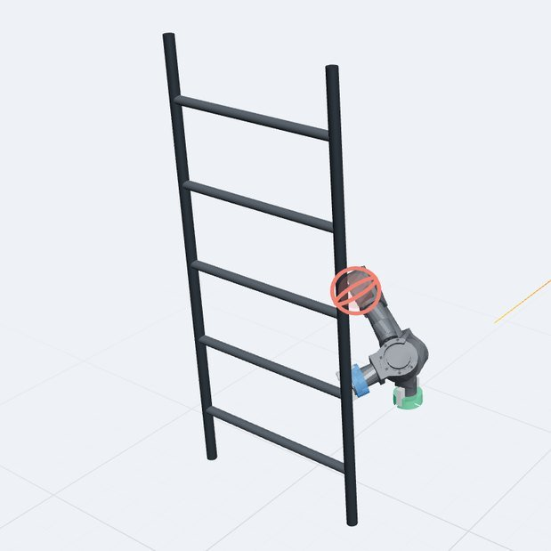

Tether turns a 7-DOF robotic arm into an untethered 7-DOF inchworm robot with a gripper on each end. It moves by switching which end is anchored. I own the mechanical and electrical design and help run the program.

## Running the project

- A roadmap of six validation gates, G0 to G5, from model freeze through integrated locomotion. Software de-risking runs in parallel with hardware bench tests.
- A shared source-of-truth repository: a numbered decision log, an open-questions and risk register, and specs tagged as verified or assumed.
- A sim-to-real rule: every fact about the robot is tagged verified, as-built, decided, or assumed, and nothing counts as verified without a measurement.

## Design decisions

- **Five modules down to three.** Each module is self-contained and wireless, and there are no separate end-effector modules.
- **A middle joint that spins 360° continuously.** The previous arm's joint limits left the IK unable to reach some poses. In the team's simulator, only the slip-ring wiring design finished both the ladder climb and the table loop.
- **No power between modules.** Each module has its own 5,000 mAh battery, aiming for about two hours of runtime. We dropped the BMS and rely on the motors' low-voltage shutoff plus a DC-DC converter per module.
- **Wireless everything.** One ESP32-class microcontroller per module. ESP-NOW first, Nordic Enhanced ShockBurst as the fallback, and BLE ruled out.

*The ladder climb in simulation, one end anchoring while the other reaches.*

- **Motion capture for localization.** SLAM is unreliable in dark, leafy outdoor conditions. AprilTags stay as the backup for docking.

## Where it stands

As of October 2026, we're finalizing the inchworm robot's design.
